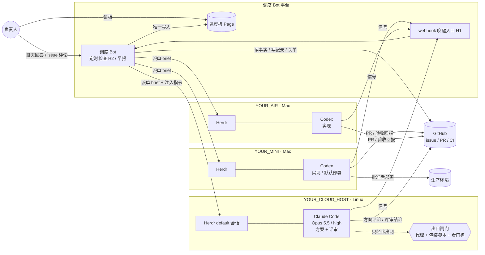
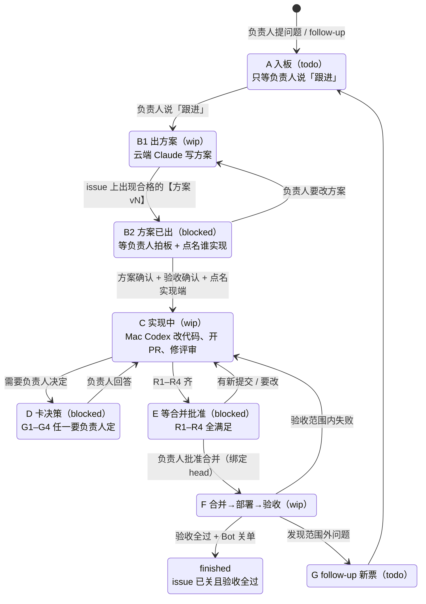
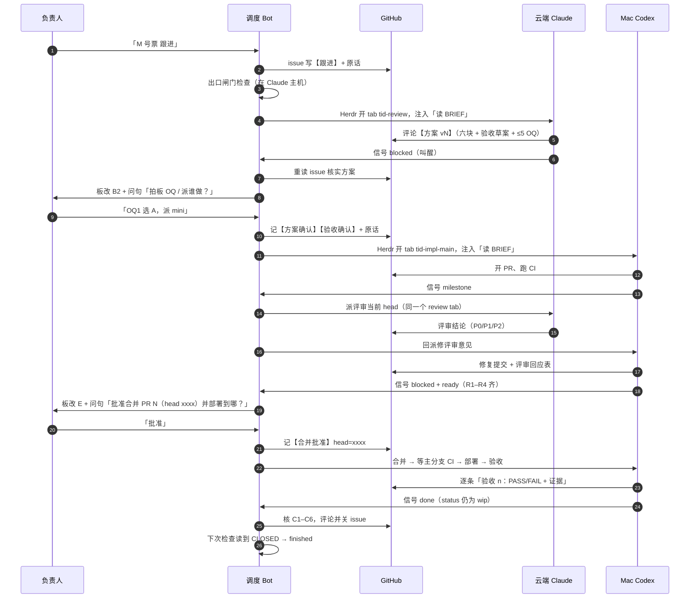
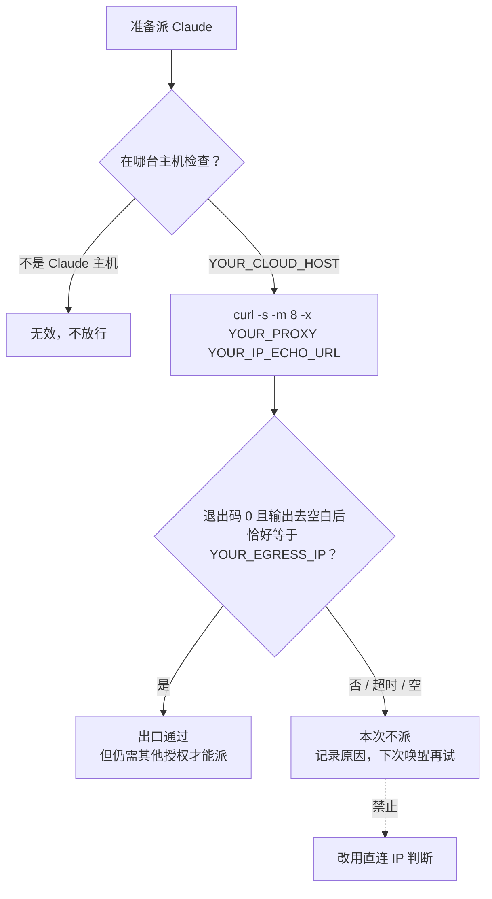

# 架构与数据流

> 路径约定：`~/ray-docs` 仅为 helper 默认的参考布局；`YOUR_` 值须由部署者填写，涉及真实主机/出口/凭据的值只留本机私有配置。

本页只讲「东西怎么连、消息怎么走」。每个专有名词第一次出现时都会用一句人话解释；更短的词表见 [README 名词小词典](README.md#名词小词典第一次见就查这里)。

占位符：`YOUR_CLOUD_HOST`（常开 Linux 云主机）、`YOUR_MINI` / `YOUR_AIR`（两台 Mac 执行机）、`YOUR_PROD_HOST`（默认部署机，通常就是其中一台 Mac）、`<TASK_ROOT>`（任务记录目录）、`<SOP_DIR>`（规则文件目录）。

---

## 1. 设计思路（为什么这样分）

| 问题 | 这套系统的做法 |
| --- | --- |
| 人没法一直盯着几台机器上的 agent | 只有一个**调度 Bot** 负责盯和汇报；人只看一张**进度板**、只回答板上的问句 |
| 不同模型擅长的事不一样、额度也不一样 | **Claude 只做设计和评审**，**Codex 只做实现**，Bot 自己的额度只用于调度 |
| 某个模型必须从固定网络出口访问 | Claude 只在一台装了**出口闸门**的主机上跑，派单前先查出口 |
| 后台 agent 跑偏了没人发现 | 所有 agent 必须在 **Herdr tab** 里跑，人随时能进去看，Bot 能列出状态 |
| 状态靠记忆、靠聊天，容易乱 | 进度板是唯一事实来源；每个任务绑定一个 GitHub issue；状态每次都按规则**重新推导**，不凭印象 |
| agent 自作主张合并/部署 | 合并、部署、关单、切线上开关都要负责人**明文批准**，批准绑定具体提交 |

---

## 2. 组件图



几点说明：

- **调度 Bot 平台**：需要四种能力——聊天、定时任务（routine）、webhook 唤醒、在每台主机执行本机 shell。参考实现用的是 Grok Bot，它通过平台自带的「机器连接」在两台 Mac 上执行命令，不依赖主机之间互相 SSH。你可以换成任何具备这四种能力的平台或自建服务。
- **进度板 Page**：参考实现是 Bot 平台里的一个画布页面。可以换成任何「只有 Bot 能写、负责人能读」的表格。
- **出口闸门**由三件东西组成：本机代理（固定出口）、`claude` 启动包装脚本（启动前查出口，不对就拒绝启动）、看门狗（每分钟查一次出口，出口异常就停掉所有 Claude 进程，并把被替换的包装脚本恢复回来）。见 §6。
- **业务仓 vs 流程仓**：业务代码在你的业务仓（`YOUR_BUSINESS_REPO`）；规则、模板、helper 脚本在流程仓（本仓）。两者分开，改流程不碰业务代码。见 §8。

---

## 3. 一张票的一生（A–G 阶段）

「阶段」是 Bot 每次检查时根据 GitHub 和 Herdr 的事实**重新算出来的**，不另外存。进度板只显示四种状态：`todo` / `wip` / `blocked` / `finished`。



| 阶段 | 板面状态 | 谁在干 | 什么时候离开 |
| --- | --- | --- | --- |
| A 入板 | todo | 没人 | 负责人明确说「跟进」 |
| B1 出方案 | wip | 云端 Claude（tab 名 `<task_id>-review`，方案和后续代码评审共用这一个 tab） | issue 上贴出格式合格的方案 |
| B2 方案已出 | blocked | 没人，等负责人 | 负责人确认方案 + 确认验收口径 + **点名**实现机器 |
| C 实现 | wip | 被点名的 Mac Codex（`<task_id>-impl-main`） | R1–R4 全满足 → E；需要决策 → D |
| D 卡决策 | blocked | 没人，等负责人 | 负责人回答 |
| E 等合并 | blocked | 没人，等负责人 | 负责人批准合并（绑定当时的 head） |
| F 收尾 | wip | 原 Codex | 合并 → 主分支 CI 绿 → 部署 → 逐条验收 → Bot 关单 |
| finished | finished | — | issue 已关且验收全勾 |
| G follow-up | 新行 todo | — | 回到 A |

**R1–R4（可以问合并的四个条件，全满足才进 E）**：
R1 执行端已声明完成；R2 当前提交的必需 CI 全绿；R3 所有评审意见都有结论（严重问题 P0/P1 已修且经 Claude 复核）；R4 GitHub 显示可合并，且「合并前」验收已勾。

**C1–C6（Bot 关单前必须核实的六件事）**：
C1 PR 已合并，合并的提交就是批准的那个；C2 合并后主分支该提交 CI 全绿；C3 要部署的已部署且有证据；C4 每条验收 PASS 或负责人接受偏差；C5 没有未回答的问题；C6 有 follow-up 的已开票并互相链接。

---

## 4. 一张票的消息流（时序）



要点：

- **信号只叫醒，不作数**。Bot 每次被叫醒都回 GitHub 重读事实再改板。
- **Bot 是唯一写板的人**。agent 和脚本都不读写进度板。
- **负责人的回答**：聊天里的明确回答，或 GitHub 上负责人本人、**不带 `【LLM：…】` 尾标**的评论。所有 bot 写的 GitHub 评论都必须以 `【LLM：…】` 结尾，以便区分。
- 负责人回答后，Bot **当回合**把原话写回 issue（`【跟进】`、`【跟进修改】`、`【方案确认】`、`【合并批准】`、`【偏差接受】`），阶段不靠 Bot 的记忆。

---

## 5. 唤醒：Bot 什么时候检查

| 入口 | 触发 | 做什么 |
| --- | --- | --- |
| **H1 看板唤醒** | 收到任一主机 POST 来的信号（webhook） | 按同一套规则重算所有开发中的行，必要时派续、改板、发问句 |
| **H2 看板兜底** | 每小时一次（参考实现） | 同 H1，另外做全量健康检查：有没有 wip 一小时没动静、负责人是否已答、有没有漏掉的信号 |
| **早报** | 每天固定时间一次（参考实现 08:00 本地时间） | 列出等负责人说「跟进」的 todo、无法核验的主机、疑似卡住的任务 |

- 需要负责人决定的问句**全天当次发送**（参考实现已取消夜间静默），同一行同一版方案只提醒一次。
- 信号投递失败、漏发，都由下一次 H2 兜底，所以 H2 不能省。
- 可选进阶：每台主机每 5 分钟跑一次本机脚本，发现 agent 停手但没写交接时自动推信号并恢复原会话一次。参考实现中此项**已设计未部署**。

---

## 6. 出口闸门（只对 Claude）



三层保护，层层独立：

1. **派单前检查**（Bot 做）：上图。
2. **启动包装脚本**：`claude` 命令本身是一个包装脚本，启动前自己再查一次出口，不对就拒绝启动；同时把代理变量注入进程。
3. **看门狗**（每分钟）：出口不对就停掉所有 Claude 进程并写告警；发现包装脚本被替换就恢复成安全版本。

**禁止**：为了让 Claude 跑起来去改包装脚本、改看门狗、换进程名绕过、或把直连结果当成通过。出口通过只说明「网络对了」，不代表可以派单。

---

## 7. 文件与目录约定

```text
<TASK_ROOT>/                         # 参考实现：YOUR_TASK_ROOT/YOUR_TASK_EVIDENCE）
├── <task-dir>/                      # 一张票一个目录，如 FEATURE-123-login-timeout
│   ├── BRIEF_CLAUDE_*.md            # 给 Claude 的派单说明
│   ├── BRIEF_CODEX_*.md             # 给 Codex 的派单说明
│   ├── DISPATCH*.md                 # Bot 的派单记录：时间、tab/pane、启动参数、出口检查结果
│   ├── PLAN_S10*.md                 # 方案全文（六块格式）
│   ├── RESULT*.md                   # 执行端结果
│   ├── BOARD_SIGNAL.md              # 本任务最新信号（helper 原子写入）
│   └── handoffs/<batch>-<worker>.md # 交接文件
├── <task-dir>-review/BOARD_SIGNAL.md # 云端评审的信号单独一个目录，序号不和执行端混用
└── board-wake/
    ├── WAKE_<时间>.md / FALLBACK_<时间>.md   # 每次 H1/H2 的判定证据（行、从→到、原因码、依据）
    ├── applied.json                          # 已应用的信号序号（去重）
    └── BOARD_ROWS.md                         # 进度板的文本镜像

<SOP_DIR>/                           # 参考实现：~/ray-docs/YOUR_COORDINATOR/sop/（每台主机同路径）
~/.config/board-wake/{webhook_url,webhook_auth}   # 每台主机自己的凭据，0600，不同步、不进 Git
~/.local/bin/board-signal-post       # 信号 helper
```

---

## 8. 业务仓 vs 流程仓

| | 业务仓（`YOUR_BUSINESS_REPO`） | 流程仓（本仓） |
| --- | --- | --- |
| 放什么 | 产品代码、测试、CI、部署脚本 | SOP、模板、信号 helper、本机脚本、移植文档 |
| 谁改 | Mac Codex，按批准的方案 | 同样走 issue → 方案 → 实现；Claude 只写设计/文档 |
| issue 用途 | 业务问题与需求 | 工作流本身的问题（看板、唤醒、派单规则） |
| 合并门槛 | R1–R4 + 负责人批准 | 同上 |
| 常见错误 | 在业务仓里改流程规则 | 把业务细节写进流程 SOP |

范围外发现的问题按归属开 follow-up：业务问题开在业务仓，工作流/协调问题开在流程仓。

【LLM：Claude@云电脑｜模型=Opus 5.5｜effort=high｜fast=否】
